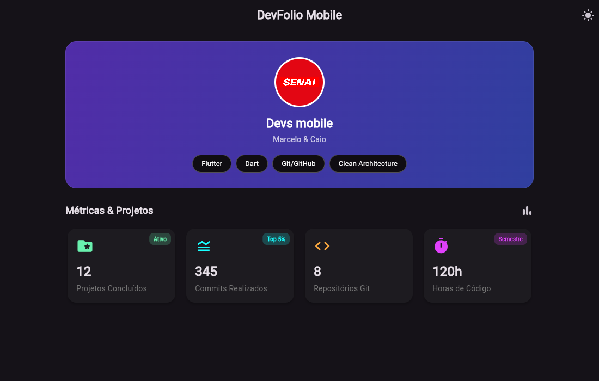

# DevFolio App

Carteira e portfólio do desenvolvedor mobile, desenvolvido em Flutter.

Projeto final do curso de Programação para Dispositivos Móveis (PPDM), turma t2dev-t3.

---

## Sobre o projeto

O DevFolio App é um aplicativo mobile/web que reúne, em um só lugar, a identidade profissional de quem desenvolve: um crachá com dados pessoais e habilidades, e um painel com as métricas dos projetos.

A ideia foi aplicar na prática o que foi estudado ao longo do semestre, como construção de layouts, grades responsivas, sobreposição de elementos, componentização do código e versionamento com Git, e ao mesmo tempo ter como resultado um portfólio que possa ser mostrado ao mercado.

## Autores

- Caio
- Marcelo ([@MarceloLTZ](https://github.com/MarceloLTZ))

## Funcionalidades

### Tela de Perfil e Crachá

- Avatar personalizado com foto de perfil, usando `CircleAvatar`
- Dados pessoais do desenvolvedor
- Cartão com gradiente (`LinearGradient`) e bordas customizadas
- Lista de habilidades exibida em chips

### Tela de Dashboard de Projetos e Métricas

- Grade proporcional com `GridView.count` para os blocos de estatísticas
- Cards do Material Design com elevação (`elevation`)
- Selos de destaque sobrepostos aos cards, com `Stack` e `Positioned`

## Capturas de tela

| Perfil e Crachá | Dashboard de Projetos |
|:---:|:---:|
|  |  |

## Tecnologias utilizadas

- Flutter e Dart
- Material Design
- Git e GitHub

## Estrutura do projeto

```
DevFolio/
├── lib/
│   ├── main.dart
│   └── widgets/
│       └── bloco_estatistica.dart
├── screenshots/
├── pubspec.yaml
└── README.md
```

O arquivo `lib/main.dart` é o ponto de entrada do app e concentra o tema (`ThemeData`) e as telas. Os componentes reutilizáveis, como o `bloco_estatistica.dart`, ficam separados na pasta `lib/widgets/`.

## Como executar

É necessário ter o Flutter SDK instalado e configurado. Para conferir, rode `flutter doctor`.

```bash
# Clonar o repositório
git clone https://github.com/MarceloLTZ/DevFolio.git

# Entrar na pasta do projeto
cd DevFolio

# Instalar as dependências
flutter pub get

# Executar na web, informando uma porta livre no lugar de PORTA
flutter run -d web-server --web-port PORTA
```

Como o servidor pode ser compartilhado via SSH, evite as portas 8080 e 8081, que costumam estar em uso por outras pessoas. Escolha qualquer outra porta que esteja disponível. Com o app rodando, basta acessar `http://localhost:PORTA` no navegador, trocando `PORTA` pelo número escolhido.

## Referências

- [Documentação oficial do Flutter](https://docs.flutter.dev)
- Building Layouts in Flutter
- Adaptive and Responsive Apps
- Debugging Layout Issues

## Informações acadêmicas

- Curso: Programação para Dispositivos Móveis (PPDM)
- Turma: t2dev-t3
- Período do projeto: 26/10/2026 a 17/11/2026
- Formato: duplas
- Apresentação final (Demo Day): 17/11/2026
